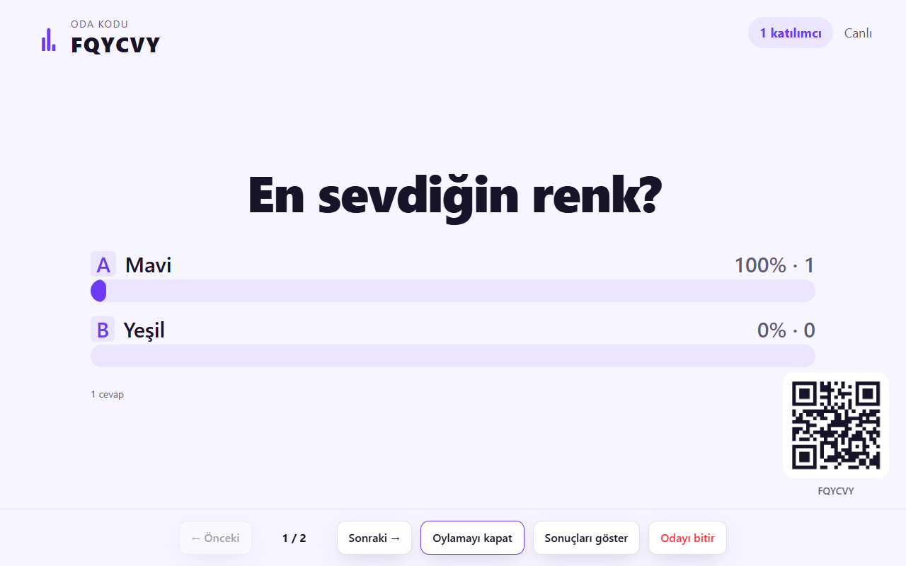
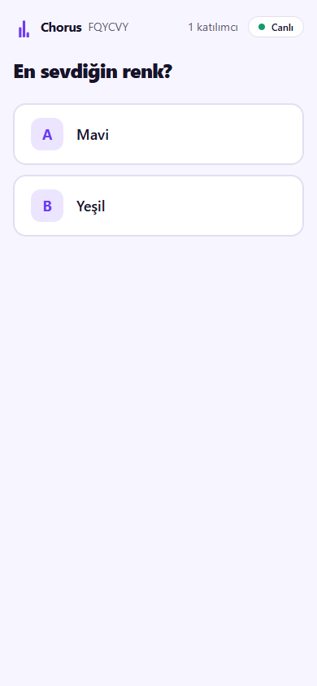
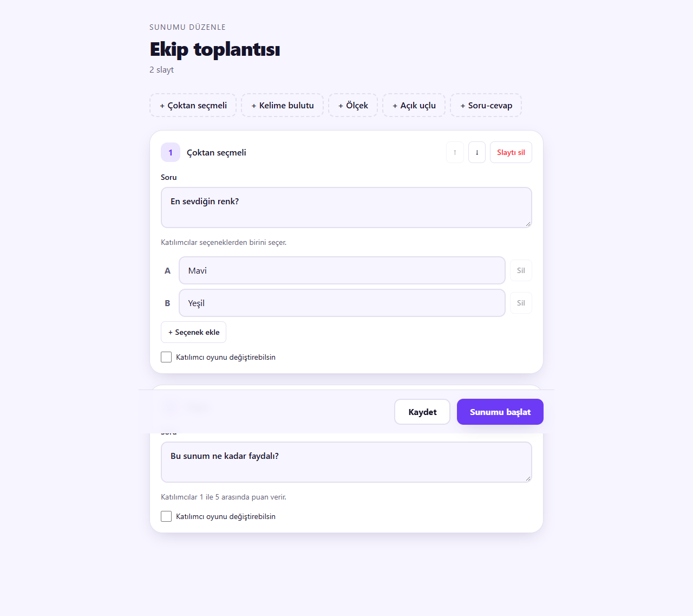
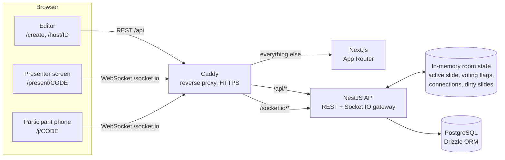
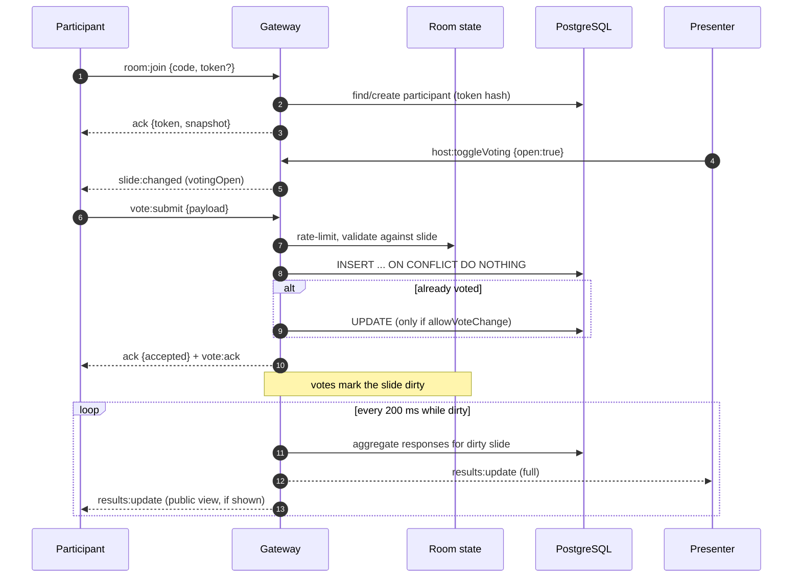
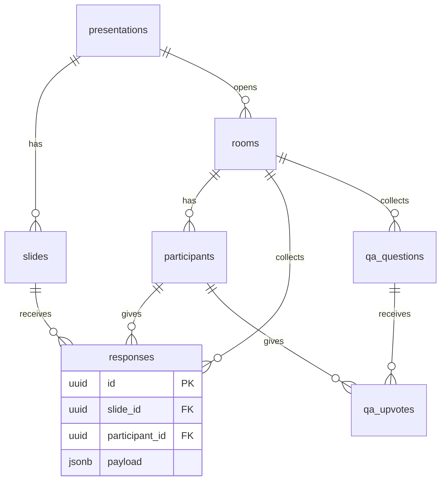

# Chorus

**Herkesin sesi, tek ekranda.** *Every voice, one screen.*

Chorus is a Mentimeter-style live polling tool. A presenter creates a session without an account, opens a room, and the audience joins from their phones by scanning a QR code. Votes and answers update live on the presenter's screen as animated charts.

> **Live demo:** _add link after deployment_ · Click **Demoyu dene** (Try the demo) to open a sample room instantly.

| Presenter screen | Participant (phone) | Editor |
| --- | --- | --- |
|  |  |  |

## Features

- **Hostless accounts:** creating a presentation returns a secret host key. Only its hash is stored; the key lives in the browser and in the edit link's fragment.
- **Five slide types:** multiple choice (2–8 options), word cloud, 1–5 scale with distribution, open text (can be hidden from audience devices), and Q&A with upvotes.
- **Live rooms over Socket.IO:** one room per session, separate host and participant sockets, automatic reconnection with the same identity (anonymous token), and restored state (current slide, own vote).
- **Presenter controls:** next/previous (also arrow keys), open/close voting, show/hide results, end room.
- **Export:** CSV or JSON of every answer, with formula-injection protection in CSV.
- **Abuse limits:** per-participant rate limit, text length limits, HTML stripping, 500-participant cap per room, idle rooms closed after 6 hours.

## Architecture



- **Persistent data** (presentations, slides, rooms, participants, responses, Q&A) lives in PostgreSQL.
- **Hot state** (which slide is active, whether voting is open, who is connected) lives in server memory. There is no Redis: a single instance is the target. See [Scaling](#scaling-path).
- **Shared contract:** `packages/shared` holds zod schemas and the typed Socket.IO event map. Server and client compile against the same types.

## Realtime flow



Results are **batched**: a burst of 300 votes produces at most one broadcast per 200 ms instead of 300.

## Data model



Constraints that enforce the rules at the database level:

- `responses (slide_id, participant_id)` is unique: one answer per participant per slide.
- `qa_upvotes (question_id, participant_id)` is the primary key: one upvote per person per question.
- `slides (presentation_id, position)` is unique.
- `rooms.code` and `participants (room_id, token_hash)` are unique.

## Technical decisions

- **Drizzle over Prisma:** Drizzle is SQL-first and lightweight, and its migrations are plain SQL files. Prisma's generated client adds memory and build weight that matters on a 1 GB server.
- **Duplicate votes are guarded by the database, not by a check-then-insert.** `INSERT ... ON CONFLICT DO NOTHING` makes concurrent duplicate votes safe. The decision logic is a pure function (`resolveVoteAction`) with unit tests.
- **Host keys and participant tokens are HMAC-SHA256 hashes** with a server secret. Comparison uses `timingSafeEqual`. A database leak does not expose working keys.
- **Batched result broadcasts (200 ms):** aggregation cost and message count scale with time, not with the number of votes.
- **Hot state in memory, durable state in PostgreSQL.** A room's runtime is rebuilt from the database when someone joins after a restart, so the only state lost on a restart is live connection bookkeeping.
- **Custom SVG/CSS charts instead of Recharts:** fewer bytes, full control of animation (spring width changes, reduced-motion support), and better accessibility labels.
- **Caddy as the single entry point:** automatic HTTPS, WebSocket proxying with no extra config, and one origin for the frontend, REST and Socket.IO (no CORS in production).
- **Renders are escaped by React; input is also cleaned on the server** (tags and control characters stripped) so stored text stays plain.

## Load test

`apps/api/scripts/load-test.mjs` connects N virtual participants in batches of 50, opens a multiple-choice slide, has each participant vote at a random moment within a 2-second window, and reads the server's `/health` (RSS and CPU time) before and after.

```bash
pnpm --filter @chorus/api load-test -- --participants 300 --api http://localhost:4000
```

| Participants | All joined | Votes accepted | Vote ack p50 / p95 / max | Result batches | Final counts match | Server RSS (before → after) | Server CPU used |
| ---: | ---: | ---: | ---: | ---: | :---: | ---: | ---: |
| 100 | 231 ms | 100 / 100 | 2 / 3 / 4 ms | 9 | yes | 99 → 130 MB | 0.50 s |
| 300 | 806 ms | 300 / 300 | 2 / 3 / 12 ms | 10 | yes | 100 → 178 MB | 1.34 s |
| 500 | 1485 ms | 500 / 500 | 2 / 3 / 4 ms | 10 | yes | 100 → 237 MB | 1.95 s |

**Test environment:** Windows 11 development machine, Node 24, PostgreSQL 16 in Docker, API and load generator on the same machine. These numbers are **not** measured on the 1 vCPU / 1 GB target; the load generator shares CPU with the server, so real results on a dedicated host will differ. RSS growth includes socket buffers for open connections.

## Running locally

Prerequisites: Node.js 20+, pnpm 9 (`corepack enable`), Docker.

```bash
cp .env.example .env          # optional for the Docker path
docker compose up --build      # db + api + web + caddy
```

Open http://localhost. The API is at http://localhost/api and Socket.IO at the same origin.

Without Docker for the app servers:

```bash
docker compose up -d db
pnpm install
pnpm --filter @chorus/shared build
pnpm --filter @chorus/api db:migrate
pnpm --filter @chorus/api dev      # http://localhost:4000
pnpm --filter @chorus/web dev      # http://localhost:3000
```

Quality checks:

```bash
pnpm test        # API unit tests (vote rules, duplicate guard, aggregation, sanitization, rate limiter)
pnpm typecheck
pnpm lint
```

## Deployment

- **Full stack on a small VPS:** set `SITE_ADDRESS`, `PUBLIC_URL` and `TOKEN_SECRET` (required in production), then `docker compose up -d --build`. Caddy obtains the TLS certificate automatically.
- **Split deployment:** the Next.js app can go to Vercel with `NEXT_PUBLIC_API_URL` and `NEXT_PUBLIC_WS_URL` pointing at the API host. The API must run on a persistent server (VPS or container) because Socket.IO keeps long-lived connections and in-memory room state. Serverless platforms cannot host it.
- **Database:** Docker Compose runs PostgreSQL locally. For production, point `DATABASE_URL` at a managed free-tier instance (Neon or Supabase).

## Known limits

- **Single instance.** Room runtime state is in memory, so the API must run as one process. Restarting it disconnects participants; they rejoin with their token and the room is rebuilt from the database.
- **Rate limiting is per participant only.** There is no IP-level limit yet.
- **Q&A broadcasts do not carry per-viewer `mine` flags.** The initial snapshot does; afterwards the client tracks its own upvotes locally.
- **Hiding individual Q&A questions** is not implemented; the schema has the column.
- **The presentation title cannot be edited** after creation (the update endpoint only replaces slides).
- **Host keys live only in the browser that created the presentation.** Clearing site data means losing edit access. There are no accounts, by design.
- **Slides cannot be reordered by drag and drop**; up/down buttons are used.
- **Interface language is Turkish only.** All strings are centralized in `apps/web/lib/strings.ts`, ready for translation.

## Scaling path

The gateway uses standard Socket.IO rooms. To run several API instances:

1. Add `@socket.io/redis-adapter` so `server.to(room).emit(...)` reaches sockets on every instance.
2. Enable sticky sessions at the load balancer (Socket.IO's HTTP long-polling fallback needs them; WebSocket-only clients still benefit).
3. Move the in-memory room runtime (active slide, voting flags, dirty set) to Redis or derive it from PostgreSQL per event, so any instance can serve any room.

## Project structure

```
apps/
  api/      NestJS, Socket.IO gateway, Drizzle schema and migrations, load test script
  web/      Next.js App Router, Tailwind, Framer Motion, socket.io-client
packages/
  shared/   zod schemas, typed Socket.IO event contract, shared types
Caddyfile                 single entry point (HTTP/HTTPS, WebSocket)
docker-compose.yml        full stack
```

## License

Portfolio project. All rights reserved unless a license file is added.
